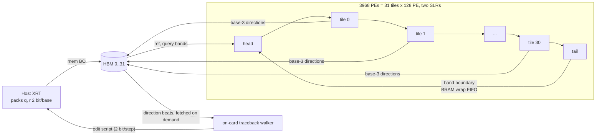

# nw-fpga-u50 — systolic Needleman–Wunsch aligner with on-card traceback, Alveo U50

A 3968-PE systolic array for **global** DNA alignment (Needleman–Wunsch; linear gap
+2 / −1 / −2) on an Alveo U50, with the **traceback also done on the card**. It was found
through an agent-driven search of the design space (tile size, tile count, floorplan,
band scheduling, packing) that a human steered.

> **Status: working research prototype, partly measured.** One hardware measurement of the
> headline build exists (3 timed repetitions in one run). Power, repeated-run spread,
> optimized CPU/GPU baselines and an independent software cross-check are **not done
> yet** — see [Status](#status-honestly).

## Headline number

| Metric | Value | Label | Evidence |
|---|---|---|---|
| Throughput, build **S1t** (on-card traceback) | **803.4 GCUPS** | **kernel-only, measured on the card**, best of 3 reps (median 803.0) | `results/linear_s1t_gate_35a63b96/metrics.txt` (`perf_gcups_min 803.39`) |
| Array / clock | 3968 PE (31 tiles × 128) @ ≈205 MHz | routed clock after v++ auto-scaling (target 300 MHz) | ledger row `35a63b96`; `docs/WORKLOG.md` |
| Workload | 182,528 × 181,019 (query padded to 46 bands of 3968; reference 181,019) | cells counted = 33.04 G | `results/.../results.csv` |
| End-to-end, same run | 566.9 GCUPS (58.3 ms = kernel 41.1 + on-card walk 13.8 + ops readback 3.4) | **end-to-end as defined by the host program**; exact scope of "end-to-end" is being re-checked (Step 5) | `results/.../stdout.txt` |
| Theoretical peak at that clock | 3968 × 205 MHz ≈ 813 GCUPS | theoretical (arithmetic) | |
| Best kernel-only of any build, **host** traceback | 878.6 GCUPS @ 246.5 MHz (build S1) | kernel-only, measured | `results/ledgers/linear.csv`, gate `09bbbe4e` |

**Note on figures.** An earlier internal summary quoted "870 GCUPS at ~230 MHz"; no log, ledger or note supports that figure, so it is not used here. The nearest measured values are 878.6 GCUPS @ 246.5 MHz (build S1, traceback on the host) and the S1t figures above (on-card traceback). The algorithm is **Needleman–Wunsch (global)**, not Smith–Waterman (local); the code and notes say so throughout.

## What it is

* **Problem:** score and trace back a global alignment of two ~181 kbp genomes
  (match +2, mismatch −1, gap −2, linear gap) — 3.3·10¹⁰ DP cells.
* **PEs store score *differences*, not scores.** Adjacent DP cells differ by a small
  bounded amount (deltas live in [−2, 4], `linear/src/nw_wave.h:76`), so each PE keeps
  3-bit deltas instead of wide absolute scores. Full derivation, proof of the value range and the dataflow: [`docs/ARCHITECTURE.md`](docs/ARCHITECTURE.md).
* **Bands.** The query is cut into bands of 3968 rows (one row per PE); the reference
  streams through the array once per band. Band boundaries wrap on-chip through a BRAM
  FIFO so the array never drains (`linear/src/kernel_tile_1b_s1t.cpp` header, "S1c").
* **Traceback directions** are written to HBM as base-3 packed symbols while scoring, and
  an on-card walker (`linear/src/wv_tb_walk.h`) reads them back through the HBM switch and
  returns only the edit script. Results in the S1t run: 198,650 ops, 1,426 direction
  fills, path score == CPU optimum.



## The agent search

Knobs: PE count (512 … 4800), PEs per tile (128/160), tile count and SLR split, HLS
`hls::task` ring vs one dataflow region per band, seam position (16 or 10 tiles), floorplan
constraints, direction packing (2-bit vs base-3), and Vivado placement directives.
Objective: *scoring GCUPS, kernel-only, with traceback present in every build*, reported next
to end-to-end, with numbers labelled measured / projected.

Scale, counted from the archive ([`docs/ITERATIONS.md`](docs/ITERATIONS.md)): **47 link jobs**
(5 on the earlier bit-parallel kernel, 40 on the wavefront kernel, 2 recovery jobs) over
2026-10-06 → 10-30, ≈ 91 h of cluster wall-clock; 15 of the 40 wavefront links produced an
xclbin directly, 12 died before place-and-route, 9 in it, 4 were cancelled; 83 numbered
note sections and a 34-row hardware ledger.

How it was run: **guided by hand, one result → one diagnosis → one next change, with two small
grids** (a clock-ask probe and an S1c seam × fan-out 2×2); there is no automatic search
harness in the archive. The user set direction, rules and several design ideas (5-in-8
direction packing, single control bundle, decoupling tile from channel, on-card traceback);
the agent ran the debugging between jobs and launched three relink variants unprompted. The
user's own call on seam position (10 tiles in SLR0) measured *worse* (705.5 vs 822.8 GCUPS).
Details, quotes and the full per-build table are in `docs/ITERATIONS.md`.

## Status, honestly

**Verified**
* Score and full optimal path **PASS on silicon** for the headline build on two
  workloads: 7,936 × 20,000 and 182,528 × 181,019 (kernel score 81,778 == CPU reference;
  card-produced edit script identical to the host walker on the small case)
  — `results/linear_s1t_gate_35a63b96/`.
* The on-card walker matches the host walker and the DP optimum on 13 local cases
  (`make test`, runs on a laptop).

**Measured, not yet at the standard needed for a claim**
* Throughput comes from **one gate run, 3 timed repetitions**, no run-to-run spread.
* No power measurement. No GCUPS/W.
* The "CPU reference" in the ledger (116.9 s) is a plain scalar check, **not** a tuned
  multithreaded baseline. No GPU/FPGA comparison is made here yet.
* Independent software cross-check (parasail/SSW) is not set up yet.

**Known limitations**
* Global alignment only; the difference-recurrence trick is specific to the scoring set
  (`docs/ARCHITECTURE.md`).
* The clock is the limit, not the PE count: S1t routed at WNS −1.536 ns for a 3.33 ns
  target and was auto-scaled to ≈205 MHz; the faster 246.5 MHz build (S1) pays 10 % band
  overhead and uses host traceback.
* The S1t bitstream came from a recovered implementation run (`v++ --reuse_impl`) after the
  scheduler's time limit hit during `write_bitstream` (`NOTES N81/N82`).
* The hardware flow (`make hw`) has not been re-run from this repository; see
  [`docs/ENVIRONMENT.md`](docs/ENVIRONMENT.md) "Known gaps".

## Build and run

```bash
# Anywhere (no FPGA tools): local checks
git clone https://github.com/Xilinx/HLS_arbitrary_Precision_Types third_party/HLS_arbitrary_Precision_Types
export AP_INT_INC=$PWD/third_party/HLS_arbitrary_Precision_Types/include
make test

# With Vitis 2025.1 + XRT (+ a U50 for run/bench)
source scripts/env.sh
make sw_emu PE=512 ; make hw_emu PE=512      # emulation targets, untested
make hw                                        # 3968 PE, hours; read AUTO-FREQ-SCALING in the log
make run   XCLBIN=build/hw/nw_tile_u50.xclbin  # 2-band check on the card
make bench XCLBIN=build/hw/nw_tile_u50.xclbin  # 181 kbp, 3 reps
```

## Layout

```
linear/    headline design (S1t): src/ kernel + walker, host/, test/, cfg/ (HLS + link), tools/
results/   raw run outputs and the hardware ledgers the numbers above come from
docs/      ARCHITECTURE.md, ITERATIONS.md, ENVIRONMENT.md, WORKLOG.md (what was done, found, still open)
```

License: [MIT](LICENSE).
