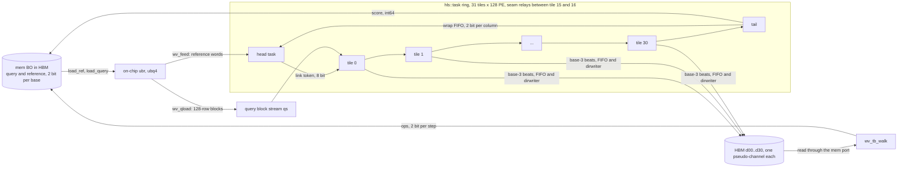

# ARCHITECTURE — how the S1t build works, and why it is shaped this way

Step 3 of the project record. Every claim cites `file:line` of this repository, a result file,
or the iteration table in [`ITERATIONS.md`](ITERATIONS.md). Numbers marked **[checked]** were
recomputed for this document (Python, scratch scripts described in §10); numbers marked **[M]**
were measured on the card; **[E]** are estimates; `UNKNOWN` says what would settle it.

## 0. The design in four sentences

A systolic array of 3,968 processing elements (PEs) aligns two DNA sequences with
Needleman–Wunsch (global, match +2 / mismatch −1 / gap −2). Each PE keeps only **score
differences** between neighbouring cells (three possible values, 3 bits), so its whole update is
one 7-input lookup table. The query is cut into bands of 3,968 rows; the reference streams through
the array once per band, and the bottom row of each band is wrapped back to the top through an
on-chip FIFO so the array never empties. Every PE also emits a 3-valued traceback direction per
cell, which is packed five-per-byte into HBM, and a walker on the same chip follows the optimal
path back through that memory and returns only the edit script.

| Fact | Value | Source |
|---|---|---|
| Array | 31 tiles × 128 PE = **3,968 PE** | `kernel_tile_1b_s1t.cpp:140-147`, `linear/cfg/tile_link_tb3968_1bt.cfg` |
| Routed clock | **205.3 MHz** (asked 300) | `ITERATIONS.md` row 45, xclbin `DATA_CLK 205` |
| Cells per cycle | 3,968 (one per PE) | one `tile_pes` iteration per PE per cycle, `:529-551` |
| Peak | 3,968 × 205.3 MHz = **814.6 GCUPS** [checked] | arithmetic |
| Measured scoring | **803.4 GCUPS** kernel-only [M] | `results/linear_s1t_gate_35a63b96/stdout.txt` |
| Stored per cell | 1.6 bits of direction | §6 |
| Device state | per PE ≈ 12 bits of recurrence state (dv 3, dh 3, rc 2, act 1, query 2, live 1) | `:496-505`, `wv_qblk` `:450` |

## 1. Block diagram and code map



| Piece | What it does | Where |
|---|---|---|
| `nw_tile_u50` | top level, the only m_axi master besides the 31 direction ports; loads query/reference on chip, runs the ring, stores the score, calls the walker | `kernel_tile_1b_s1t.cpp:1839-2236` |
| on-chip buffers | `ubr` reference (64 KB at `WV_NMAX` = 262,144 bases), `ubq4` query (64 KB at `WV_MMAX` = 262,144) | `:2094-2095`, `:257-269`, `:425-429` |
| band geometry | `nb`, stride `S = n + g`, `cmax`, `nbeats`, token count `T` | `:2098-2108` |
| `wv_ring` | the dataflow region: creates streams (`lk`, `qs`, `cs`, `ds`, `wrap`, …) and the tasks | `:1487-1832`; streams `:1593-1611` |
| `wv_head_t` | emits one 8-bit link token per cycle: reference base, active flag, boundary delta from `wrap`, markers | `:1325-1382` |
| `wv_tile_t` / `wv_tile_group` | one tile = 128 PEs; runs the recurrence and packs directions (variant V12, the shipped one) | `:600-656`, `:488-581` |
| PE body | `idx = (smatch, dh_up, dv)`, table lookup, update `dv`, `dh`, direction | `:536-546`, table `nw_wave_lut.h:56-73` |
| seam relays | three register stages between tile 15 and 16 (SLR0 → SLR1) | `:1672-1682` |
| `wv_tail_t` | takes the last PE's `dH`: bands 0…nb−2 → `wrap`; last band → telescopes into the score | `:1389-1414` |
| `wv_feed`, `wv_qload` | stream the reference words / 128-row query blocks from chip RAM into the ring | `:1419-1439`, `:1443-1468` |
| `wv_dirwriter` | drains one tile's FIFO to one HBM pseudo-channel (counted loop with a linear index ⇒ AXI bursts) | `:1470-1479` |
| `wv_tb_walk` | on-card traceback (S1t) | `wv_tb_walk.h:84-201` |
| scalar models | `nw_wave_scalar` / `nw_wave_dirs` (C model of the array), `nw_align_ref` (golden row-major DP) | `nw_wave.c`, `nw_ref.c:20-51` |
| host | XRT program, host walker/decoder (the on-card walker is checked against it) | `linear/host/` |

Of the 2,238 lines of `kernel_tile_1b_s1t.cpp` only part is live: the file also keeps the
experimental tile variants V1–V11 of the S1c search (`#if S1C_VAR == …`, `:413-1318`). The shipped
build has `S1C_VAR` = 12 (`:403-405`, macro list in `docs/ENVIRONMENT.md`).

## 2. The scoring identity (why this recurrence is special, and when it stops working)

For a global alignment with `a` matches, `b` mismatches and `g` gap columns, `m + n = 2a + 2b + g`
(every column consumes two characters, or one if it is a gap). Then

```
score = 2a − b − 2g = (m + n) − 3(b + g)
```

so for *these* parameters maximising the score is minimising edit distance, per alignment, not
just at the optimum (`NOTES N1`, tested over 4,000 random pairs). The array does **not** use this
identity: it evaluates the DP directly, so other scoring sets would work with a different table
(`nw_wave.h:20-24`). What *does* depend on +2/−1/−2 is the 3-value property of §3.

## 3. The delta recurrence — full derivation

### 3.1 Definitions

Let `H[i][j]` be the best global-alignment score of the first `i` query bases against the first
`j` reference bases, `G = −2`, and `s(i,j) ∈ {+2, −1}`.

```
H[i][j] = max( H[i−1][j−1] + s,  H[i−1][j] + G,  H[i][j−1] + G )          H[0][j] = jG,  H[i][0] = iG
dH[i][j] = H[i][j] − H[i][j−1]        (horizontal)
dV[i][j] = H[i][j] − H[i−1][j]        (vertical)
e [i][j] = H[i][j] − H[i−1][j−1]      (diagonal)
```

### 3.2 From scores to differences

Subtract `H[i−1][j−1]` from all three terms of the recurrence. The neighbour terms become
`H[i−1][j] − H[i−1][j−1] = dH[i−1][j]` and `H[i][j−1] − H[i−1][j−1] = dV[i][j−1]`, so

```
e [i][j] = max( s,  dH[i−1][j] + G,  dV[i][j−1] + G )
dV[i][j] = e[i][j] − dH[i−1][j]           (H[i][j] − H[i−1][j]  =  e + H[i−1][j−1] − H[i−1][j])
dH[i][j] = e[i][j] − dV[i][j−1]
```

(`nw_wave.h:33-38`.) A PE needs two numbers from the past — `dH[i−1][j]`, `dV[i][j−1]` — and one
bit (does the query base equal the reference base?). It never sees an absolute score. Boundaries:
`H[0][j] = jG ⇒ dH[0][j] = G`, `H[i][0] = iG ⇒ dV[i][0] = G` (`nw_wave.h:53-55`).

### 3.3 What values can a delta take? (the proof)

**Lemma 1 (congruence).** `H[i][j] ≡ i + j (mod 3)`.
*Proof.* Take any alignment of the two prefixes with `a` matches, `b` mismatches and `g` gap
columns. Then `i + j = 2a + 2b + g` and its score is `2a − b − 2g`, so
`score − (i + j) = −3b − 3g`, a multiple of 3. Every alignment has this property, hence the
maximum does. ∎

**Lemma 2 (lower bound).** `dV ≥ −2`, `dH ≥ −2`. The recurrence contains the term
`H[i−1][j] + G`, so `H[i][j] ≥ H[i−1][j] − 2`; likewise horizontally. (On the boundary
`dV[i][0] = dH[0][j] = G` exactly.) ∎

**Lemma 3 (upper bound).** `dV ≤ 4`, `dH ≤ 4`.
*Proof.* Take an optimal alignment of `(i, j)` and look at query base `q_i`.
(a) If `q_i` is in a gap column, deleting that column gives an alignment of `(i−1, j)` scoring
`H[i][j] − G = H[i][j] + 2`. (b) If `q_i` is paired with some `r_k`, replace the column
`(q_i, r_k)` by `(−, r_k)`: the score changes by `−s + G ≥ −2 − 2 = −4`. Either way
`H[i−1][j] ≥ H[i][j] − 4`. ∎ This is why the range is **[−2, 4]**, not the textbook [gap, match] =
[−2, 2]; the code comments flag the textbook bound as wrong (`nw_wave.h:43-45`,
`nw_wave_lut.h:29-30`).

**Corollary (three values).** `dV[i][j] ≡ (i+j) − (i−1+j) ≡ 1 (mod 3)` by Lemma 1, so with
Lemmas 2–3, `dV, dH ∈ {−2, +1, +4}`. The same congruence shows `e ≡ 2 (mod 3)`, and
`e ≤ max(s, dH+G, dV+G) ≤ 2`, `e ≥ s ≥ −1`, so **`e ∈ {−1, +2}`**.

**Lemma 4 (closure — what the hardware actually relies on).** If `dH_up, dV_left ∈ {−2, 1, 4}`
and `s ∈ {2, −1}`, then the outputs are again in `{−2, 1, 4}`. *Proof by case check*: the 18
combinations are in §3.5. Together with the boundary value `G = −2 ∈ {−2, 1, 4}` this is an
induction over the whole table: the register can never leave the set, whatever the sequences.
(Lemmas 1–3 explain *why*; Lemma 4 is *sufficient* for correctness of the register width.)

### 3.4 Bit widths

| Quantity | Values | Stored as | Source |
|---|---|---|---|
| `dH`, `dV` in a PE | {−2, 1, 4} | 3 bits, biased `enc(d) = d + 2` ∈ {0, 3, 6} (range [0, 6] kept so the table also covers the 7 values of the measured range) | `nw_wave.h:75`, `wv_enc` `:381` |
| `e` | {−1, 2} | never stored | — |
| direction | DIAG 0 / UP 1 / LEFT 2 | 2 bits in the PE, 1.6 bits in memory | `nw_wave.h:83-85`, §6 |
| band-boundary `dH` | {−2, 1, 4} | 2 bits as `(d + 2) / 3` ∈ {0, 1, 2} | `kernel_tile_1b_s1t.cpp:1406`, decode `:1363-1364` |
| link token | dh 3 + rc 2 + act 1 + pre-marker 1 + band parity 1 | 8 bits | `:434-447` |
| sequences | A, C, G, T | 2 bits per base | `WV_RBITS` `:178` |
| final score | up to ≈ 2 × 262,144 in magnitude | int64 accumulator | `wv_cfg::acc0` `:464`, `wv_tail_t` `:1393` |

Three values would fit in 2 bits; the shipped table uses the 3-bit biased form. A 2-bit packed PE
was explored only out of context (`NOTES N65`).

### 3.5 The whole PE, enumerated

The PE's next state is a function of `(s, dH_up, dV_left)`: 18 reachable inputs, a 7-bit index
into a 128-entry ROM (`index = smatch·64 + enc(dH_up)·8 + enc(dV_old)`, output `dir·64 + enc(dH_new)·8 + enc(dV_new)`;
`nw_wave_lut.h:16-17`, `:50-54`). Ties are broken DIAG > UP > LEFT, so the reported path is an
optimal one but which optimal path depends on this priority (`nw_wave_lut.h:24-27`).

| s | dH_up | dV_left | candidates (s, dH+G, dV+G) | e | dV_out = e−dH | dH_out = e−dV | dir |
|---|---|---|---|---|---|---|---|
| +2 | −2 | −2 | +2, −4, −4 | +2 | +4 | +4 | DIAG |
| +2 | −2 | +1 | +2, −4, −1 | +2 | +4 | +1 | DIAG |
| +2 | −2 | +4 | +2, −4, +2 | +2 | +4 | −2 | DIAG |
| +2 | +1 | −2 | +2, −1, −4 | +2 | +1 | +4 | DIAG |
| +2 | +1 | +1 | +2, −1, −1 | +2 | +1 | +1 | DIAG |
| +2 | +1 | +4 | +2, −1, +2 | +2 | +1 | −2 | DIAG |
| +2 | +4 | −2 | +2, +2, −4 | +2 | −2 | +4 | DIAG |
| +2 | +4 | +1 | +2, +2, −1 | +2 | −2 | +1 | DIAG |
| +2 | +4 | +4 | +2, +2, +2 | +2 | −2 | −2 | DIAG |
| −1 | −2 | −2 | −1, −4, −4 | −1 | +1 | +1 | DIAG |
| −1 | −2 | +1 | −1, −4, −1 | −1 | +1 | −2 | DIAG |
| −1 | −2 | +4 | −1, −4, +2 | +2 | +4 | −2 | LEFT |
| −1 | +1 | −2 | −1, −1, −4 | −1 | −2 | +1 | DIAG |
| −1 | +1 | +1 | −1, −1, −1 | −1 | −2 | −2 | DIAG |
| −1 | +1 | +4 | −1, −1, +2 | +2 | +1 | −2 | LEFT |
| −1 | +4 | −2 | −1, +2, −4 | +2 | −2 | +4 | UP |
| −1 | +4 | +1 | −1, +2, −1 | +2 | −2 | +1 | UP |
| −1 | +4 | +4 | −1, +2, +2 | +2 | −2 | −2 | UP |

All 18 outputs are in {−2, +1, +4}. **[checked]** (generated by script from the recurrence).

### 3.6 Why a table and not arithmetic

As arithmetic the loop-carried path `dv → (dv+G) → max3 → (e − dv) → dv` measured 3.213 ns in HLS
(warning 200-887), because `ap_int` widens at every step; the recurrence cannot be pipelined
because `dV[i][j]` depends on `dV[i][j−1]` (`nw_wave_lut.h:7-12`, `NOTES N25`). The ROM version is
one LUT level and also yields the direction for free (same index bits, `:13-14`).

### 3.7 Verification of this section [checked]

* Brute force: 3,000 random DP tables (lengths 1–40, alphabets of 1, 2 and 4 letters, 1.24 M
  interior cells) give `dV, dH ∈ {−2, 1, 4}`, `e ∈ {−1, 2}`, and 0 violations of
  `H ≡ i + j (mod 3)`.
* The 128-entry table equals the arithmetic over all 7 × 7 × 2 in-range inputs (0 mismatches), and
  real DP uses exactly the 18 triples of §3.5 (all 18 occur).
* Repository checks: `make test` runs the walker against the host walker and the DP optimum
  (13 cases); `nww_lut_selfcheck()` asserts table == arithmetic (`nw_wave_lut.h:32-34`).

## 4. The wavefront: what happens each cycle

**Schedule.** In a tile, PE `i` works on reference column `j = t − i` at cycle `t` (counted from the
tile's first active cycle). Everything the PE needs is then one cycle old: `dH[i−1][j]` is PE
`i−1`'s output from cycle `t−1` (it handled column `j` then), and `dV[i][j−1]` is the PE's own
register from `t−1` (`nw_wave.h:46-51`). Example, 3 PEs, 4 columns (PE row `i`, cell is column `j`):

```
cycle t:   0     1     2     3     4     5
PE 0:     c0    c1    c2    c3
PE 1:           c0    c1    c2    c3
PE 2:                 c0    c1    c2    c3        n + PE − 1 = 6 cycles for the band
```

**Per cycle in one tile** (`wv_tile_group`, `:503-580`): read one link token from upstream;
snapshot all 128 `(dh, rc, act)` registers (so the 128 updates behave as simultaneous, `:519-528`);
for every PE `i` take `dh_up`, `rsym`, `afl` from PE `i−1` (PE 0 from the token), and if active and
live compute `smatch`, look up the table, update `dv[i]`, `dh[i]`, produce `dcode`; if the tile is
in its counted window, fold `dcode` into the byte accumulator (`pk = pk·3 + dcode`); every fifth
cycle emit the packed bytes to the FIFO; finally write the last PE's `(dh, rc, act)` as the next
link token (`:578`).

**The link token** carries exactly what the next PE row needs: the reference base `rc`, the
active flag, the horizontal delta `dh`, and two marker bits. Nothing is broadcast — no net grows
with the PE count — which is the reason the clock closes at all (see §9 for where it still did not).

**Tile boundaries are free to register.** Only `dV` is loop-carried and it never leaves a PE;
`dh/rc/act` flow forward only. An extra register at a tile boundary delays that tile's whole
wavefront by one cycle and everything stays consistent, so the seam relay between tile 15 and 16
(three stages, SLR0 → SLR1) cannot break the schedule (`NOTES N29`, `:1672-1682`).

**Dead PEs pass `dH` through** (`:544-545`): when the query ends mid-band, the unused PEs forward
`dh_up` unchanged, so the last PE of the last tile always carries the bottom row of the real query
and no 3,968-way output mux exists.

**Position is counted, never derived from the loop index.** A tile counts `c` from its own first
active token; FIFOs and relays shift timing without moving any address (`:215-220`).

### 4.1 Score without storing scores

The corner is `H[m][n] = H[m][0] + Σ_j dH[m][j] = mG + Σ_j dH[m][j]`. Only the last band's bottom
row is summed: `acc0 = G·m` is loaded, the tail adds `dh_out` of every active token of band
`nb−1` (`:1401-1405`, `acc0` at `:2132`).

## 5. Banding and the boundary handoff

**Bands.** `nb = ceil(m / 3968)`; band `b` holds rows `b·3968 … b·3968+3967`, tile `k` holds 128 of
them (`:2098`; 182,528 rows = 46 bands exactly). The reference streams through once per band.

**What crosses a band boundary** is the bottom row's `dH` per column — 2 bits per column — and
nothing else: each band starts with `dV[i][0] = G` in every PE (reset at the start of every
band group, `:503-506`), exactly the global-alignment boundary, so there is no other band-to-band state. The tail
packs the row 32 columns to a 64-bit word into the `wrap` FIFO (BRAM, depth
`(WV_NMAX+31)/32` = 8,192 words = 64 KB [checked]) and the head decodes it for the next band
(`dh = 3·code − 2`, `:1363-1364`).

**Why the array never drains (S1c).** Band `b+1` column `j` is needed at stream position
`(b+1)·S + j`; band `b`'s tail produced it at about `b·S + j + PE`. The slack is `S − PE`, so with
stride `S ≥ NMIN = PE + 8·128 = 4,992` the data is always already there (`:10-24`, `:407-412`).
`S = n + g`, where `g = 640` idle tokens follow every band at 181 kbp (`WV_BWIN`, `:417-421`;
the comment at `:14-20` saying "g = 0" is stale for the shipped variant, **[checked]** against
`WV_GAP_OF`). During the idle window every lane of a tile is idle, which is where the query block
for the next band is swapped in (`WV_BSWAP`, `:420`, `wv_tile_t:640-654`).

**Tokens for one run** (`:2104-2108`): `T = 1 + nb·S + PE + 2·128`.

### 5.1 Where the peak goes [checked]

For m = 182,528, n = 181,019 (46 bands) at 205.3 MHz:

| Step | Cycles | Cumulative GCUPS | Source |
|---|---|---|---|
| Peak PE × f | — | 814.6 | arithmetic |
| fill + lead: `1 + PE + 2·128` = 4,225 | 4,225 | | `:2108` |
| idle gaps: 46 × 640 = 29,440 | 29,440 | model **811.35** (0.40 % below peak), 8,360,539 cycles = 40.72 ms | `:2100-2108` |
| load phases: reference 5,657 + query 5,704 cycles | 11,361 | 40.78 ms | `:2113-2130` |
| XRT launch ≈ 0.1 ms | ≈ 20,500 | 40.88 ms | measured on another build (`NOTES N64`) |
| unexplained | ≈ 51,000 (0.25 ms, 0.6 %) | **measured 41.127 ms = 803.4 GCUPS [M]** | `stdout.txt` |

The measured number is within 1.0 % of the model; the last 0.6 % is **UNKNOWN** — settled by a
cosim cycle count of the 3,968 build or an XRT profile of the launch.
GCUPS here counts all 182,528 × 181,019 = 33.04 G cells (the problem *is* 182,528 rows, because the
benchmark asks for 46 whole bands). For the true 181,019² square the same time would be 796.8
(computed, not logged).

## 6. Traceback directions

### 6.1 Base-3 packing

A direction has three values, so five fit one byte: `3⁵ = 243 ≤ 256`, i.e. **1.6 bits/cell** against
the floor `log₂ 3 = 1.585` (`:281-306`). Grouping is along *time* (128 is not divisible by 5): five
counted cycles give each lane five consecutive directions, `byte = d0·81 + d1·27 + d2·9 + d3·3 + d4`
with the **first** cycle most significant (`acc = acc·3 + d` per cycle, `:550`). The multiply
runs for every lane on every counted cycle, active or not (`d = 0` when inactive), because the digit
position *is* the multiply count. One group = 128 bytes = exactly two 512-bit beats
(`WV_DIR_SG = 1`, `:324-329`).

### 6.2 Where a cell's direction lives

For cell `(i, j)` (1-based), `row = i−1`, `col = j−1`:

```
band = row / PE;  k = (row % PE) / 128;  il = row % 128
c    = band·S + col + il                    counted cycle of tile k
beat = (c / 5)·2 + il / 64                  byte il % 64 of that beat, digit c % 5 (MSD first)
```

(`wv_tb_walk.h:27-30`, mirrored by the host decoder `host/nw_host_traceback.c:86-158`.) Tile `k`
owns HBM pseudo-channel `k` (`d_k` bundle `gd{k}`, link cfg).

### 6.3 Memory math [checked]

```
clast  = (nb−1)·S + n + 128 = 45·181,659 + 181,019 + 128           = 8,355,802
cmax   = ceil(clast / 5)·5                                          = 8,355,805
nbeats = cmax/5 · 2                                                 = 3,342,322 beats per tile
bytes  = nbeats · 64 B                                              = 213,908,608 B = 204.0 MiB per tile
total  = 31 tiles                                                   = 6.631 GB (6.18 GiB)
```

This matches the host's own report `dir=204.0 MiB/port × 31` (`stdout.txt`). It is 1.6055 stored
bits per padded cell (33.04 G cells). One pseudo-channel is 256 MiB = 4,194,304 beats, so each
buffer fits its channel with 20 % to spare.

**Capacity limit (derived, not measured).** The binding limit is one 256 MiB channel per tile:
`nbeats ≤ 4,194,304`. With n = 181,019 that allows m ≤ ≈ 223,000; for m = n it allows ≈ 202,000
bases. The 181 kbp figure in the older notes came from 2-bit storage on 8 GB of HBM; base-3 raised
it. The on-chip buffers (`WV_NMAX`, `WV_MMAX` = 262,144) are not the binding limit.

### 6.4 Bandwidth

Each tile emits 128 B per 5 cycles = 25.6 B/cycle, i.e. 5.26 GB/s per channel and 162.9 GB/s in
total at 205.3 MHz [checked], against 9.875 GB/s per pseudo-channel (53 %) and 316 GB/s for the
stack (52 %). Cosim does **not** model this (`NOTES N55`). A FIFO of 32 beats between each tile
and its writer keeps an HBM hiccup out of the recurrence (`:360-374`).

## 7. On-card traceback (S1t)

**Why.** The host version fetched ~1,426 direction windows through XRT, ~27 µs per sync, 32–43 ms
at 181 kbp, as long as the alignment itself (`wv_tb_walk.h:2-9`).

**How it reaches memory without a new port.** All 32 AXI connections are in use (31 direction
writers + `mem`). The link maps `mem` to HBM[0:31], so the one control port can read every
direction buffer through the HBM switch. The host writes each buffer's address relative to `mem`
into a descriptor at `mem[b_off]` (`:11-25`).

**Algorithm.** Start at `(m, n)`; at each cell read the 2-bit direction, emit it as one op, step
`i`, `j` or both, until `(0, 0)`. On the edges (`i = 0` or `j = 0`) only one move is legal and no
memory is read. Within one tile run (fixed tile, fixed band) every move lowers `c` by 1 (UP, LEFT)
or 2 (DIAG), so `(c/5, c%5)` are carried with a borrow and **the step loop never divides**; a division
happens once per tile run (`:121-125`, `:192`). One cache fill of 128 beats (8 KB) ending at the
current beat serves a whole tile run (`:100-144`). A path from (m, n) to (0, 0) crosses every (band, tile) block, and one fill covers a block (a run
spans ≈ 64 beats against a 128-beat window), so the expected fill count is `46 × 31 = 1,426`; the run
reports exactly 1,426 [M, checked]. That equality is a consequence of this geometry, not a proof
that a fill never repeats.

**Cost model.** 1,426 fills × ≈ 1,099 cycles + 198,650 steps × II 5 ≈ 2.56 M cycles ≈ 12.5 ms at
205.3 MHz [checked] against 13.8 ms measured (the 1.3 ms difference is **UNKNOWN**). The walker
also re-scores the path it walked (`:167-174`) and returns it, so the host check "path score ==
DP optimum" costs nothing extra.

**The end-to-end figure, defined.** The host's number is the time of one `run.start() … wait()`
with the walk enabled (kernel + walk, 54.921 ms) plus the device → host readback of the
descriptor and ops (3.363 ms), total 58.28 ms (`nw_gate_host.cpp:334-353`, `:496`, result line in
`stdout.txt`). It **excludes** host-side packing, buffer allocation, the 0xFF pre-fill and upload of
the 6.3 GB of direction buffers (a test aid so missing writes are visible), and the host → device
upload of the two sequences. This answers open question 3 of `docs/WORKLOG.md`.

## 8. Reading the build as a pipeline of decisions

| Design choice | Why | Evidence |
|---|---|---|
| Delta form, 3-bit state | registers stay small, no wide adders, PE = one LUT | §3 |
| Nearest-neighbour only | no net grows with PE count; Myers' bit-parallel failed on a 21,404-pin enable net | `NOTES N19`–`N23`, `ITERATIONS.md` row 1 |
| Tiles of 128 | compile time (per-module compile peak ≈ 3.12·TILE² instructions), one 256-bit port per tile | `:76-122`, `NOTES N29` |
| One AXI master per tile, 31 + 1 = 32 | the HBM subsystem exposes 33 connections and the shell takes one | `NOTES N49`, `ITERATIONS.md` rows 22, 25 |
| Base-3 directions | 20 % less HBM traffic than 2-bit | `NOTES N44` |
| Boundary on chip, then continuous bands | HBM round trip per band halved throughput; per-band drain cost 10 % | `ITERATIONS.md` rows 29, 37, 40 |
| Walker on the card | host syncs cost as much as the alignment | §7 |

## 9. Physical limits — what stops it going faster

| Limit | Numbers | Evidence |
|---|---|---|
| Routed clock, not PE count | the S1c/S1t routes failed with 0–1 logic levels and 4–5 ns of wire; WNS −1.536 ns at 3.333 ns → 205.3 MHz; area is 49 % of the user LUT budget | `ITERATIONS.md` rows 40–45; `RPT s1t` |
| AXI budget | 32 usable connections; 31 direction writers + `mem`; 4096 PE (32 tiles) would need 33 | `NOTES N49` |
| Direction bandwidth | 163 GB/s of 316 at this clock (53 % of a channel); would exceed 316 at 4096 PE with 2 bits/cell | §6.4, `NOTES N44` |
| HBM sits in SLR0 | every direction writer is anchored there; moving tiles to SLR1 pushes 512-bit beats across the seam (no Laguna registers used) | `ITERATIONS.md` rows 19, 29, 31 |
| CLB sites | SLR0 CLB 99.36 %, SLR1 70.97 % at 48.8 % LUT: the sites, not the LUTs, fill | `RPT s1t` slr_util_routed |
| Platform DMA clock | any negative slack on `dma_ip_axi_aclk_1` is fatal (unscalable): 12 ps lost one 3 h build | `ITERATIONS.md` row 30 |
| Capacity | one 256 MiB channel per tile ⇒ ≈ 202 kbp square, ≈ 223 kbp query at n = 181,019 | §6.3 |
| Time limit | 6 h Slurm limit cut `write_bitstream`; recovered by `--reuse_impl` | `ITERATIONS.md` rows 45–47 |

## 10. How the checks in this document were made

All run on a laptop, not on the card, from the files in this repository: (1) brute-force DP and
the mod-3 / range / table checks of §3.7; (2) the sizes of §5.1 and §6.3, recomputed from
`kernel_tile_1b_s1t.cpp:2098-2108` and the `WV_GAP_OF` macro; (3) the `make test` suite described in
`docs/ENVIRONMENT.md`. The scratch scripts are not committed (they read the private evidence folder).
The throughput model of §5.1 is arithmetic, not a simulation: a cycle-accurate check would need a
cosim run of the full 3,968-PE kernel (not done).

## 11. Terminology

| Term | Meaning here |
|---|---|
| PE | processing element: one DP row, one cell per cycle |
| tile | 128 PEs compiled as one module, one hls::task, one direction port |
| band | 3,968 query rows processed in one pass over the reference |
| link token | the 8-bit value passed PE-row → PE-row each cycle |
| wavefront / anti-diagonal | PE `i` is `i` cycles behind PE 0; cells with equal `i + j` are processed in the same cycle |
| delta (`dH`, `dV`) | difference of neighbouring DP scores |
| stride `S` | tokens per band including idle gap |
| SLR / SLL | one die of the U50's two / the wires crossing the seam (23,040) |
| pseudo-channel (PC) | one of 32 × 256 MiB HBM channels, 9.875 GB/s each |
| beat | one 512-bit AXI word |
| GCUPS | 10⁹ DP cells updated per second. Kernel-only = scoring kernel with the walk disabled; end-to-end = as defined in §7 |

## 12. Exercise for you (do this on paper first)

1. Derive `e`, `dV_out`, `dH_out` from the recurrence without looking at §3.2.
2. Prove `H ≡ i + j (mod 3)` and from it that deltas take only three values.
3. Prove the upper bound 4 by the deletion argument; then redo it for a gap penalty of −3 and say which of the three lemmas survive.
4. For PE = 3, n = 4, draw the table of §4 and mark which register each PE reads at each cycle.
5. Recompute `nbeats` and the 204 MiB per tile from `n = 181,019`, `m = 182,528`.
