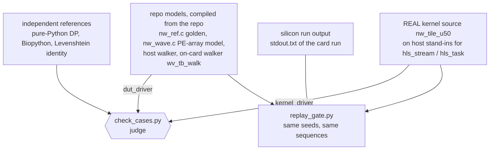

# Verification

What was checked, against what, how strong each check is, and what is **not** checked.
Every number below comes from a report in [`results/verification/`](../results/verification/) produced by
`linear/verify/verify_all.sh` (one command, 21 min on an Apple-silicon laptop, no FPGA tools). `UNKNOWN` says what would settle it.

## 0. Verdict

| Claim | Status | Evidence |
|---|---|---|
| The delta recurrence + PE table compute the exact Needleman–Wunsch score (match +2 / mismatch −1 / gap −2, linear gap) | **Verified** on 23,141 case-runs, 1.49 G cells, 0 failures, at array sizes 128 / 512 / 3,968 PE | §3 |
| The real kernel source (`kernel_tile_1b_s1t.cpp`, top `nw_tile_u50`) gives the right score, a valid optimal path, and writes directions in the layout the walkers decode | **Verified functionally** on 15,346 case-runs (7,673 at 512 PE, 7,673 at 3,968 PE with 31 tiles and seam relays), 1.47 G cells, 0 failures. *Functional only*: see §5 for what the host stand-ins cannot show | §4 |
| The two silicon runs (`results/linear_s1t_gate_35a63b96/`) are reproduced by the repo's own models | **Verified**: scores, the walker's step count, cache fills and path score all equal the card's printed values | §6 |
| The test harness can fail | **Verified**: 14 of 14 planted bugs caught; one deliberate no-op edit survived, as it must | §7 |
| RTL, timing, HBM behaviour, deadlock-freedom of the 3,968-PE ring | **Not verified here.** Earlier Vitis csim/cosim runs exist for small cases (§8); the ring was proven by the two hardware runs only | §9 |
| Op-for-op equality of silicon output with the model | **UNKNOWN.** The card run saved counts and scores, not the op stream. Settled by: printing an md5 of the ops buffer in `nw_gate_host.cpp` on the next card run | §9 |

## 1. The layers, and what each can catch



| Layer | Source under test | Can catch | Cannot catch |
|---|---|---|---|
| models (`dut_driver`) | `nw_wave.c`, `nw_wave_lut.h`, `nw_host_traceback.c`, `wv_tb_walk.h` | recurrence, table, banding, boundary hand-off, base-3 layout and decode, walker logic | anything that only exists in the kernel's own code |
| real kernel (`kernel_driver`) | `kernel_tile_1b_s1t.cpp` | tile code (V12), head/tail/wrap handling, query block forwarding, direction packing and writer, band stride `S`, on-card walker as integrated | timing, FIFO depths, RTL, AXI, HBM, scheduling |
| silicon replay | both of the above vs the card's printed numbers | model or kernel disagreeing with what the card really returned | op-for-op equality (the ops were not saved) |

## 2. The independent references

They share no code with the repo, which is what makes a pass meaningful.

| Reference | What it is | Used for |
|---|---|---|
| `ref_py` (in `check_cases.py`) | ~15-line full-matrix Needleman–Wunsch in pure Python, own tie-break DIAG > UP > LEFT | score for cells ≤ 150,000; the **complete direction matrix** for cells ≤ 60,000 |
| Biopython 1.88 `PairwiseAligner`, global, match 2 / mismatch −1 / open = extend = −2 | a separate, library implementation | score of every case, including the 33 G-cell silicon workload |
| Levenshtein distance | identity `score = (m + n) − 3·edit distance` ([`ARCHITECTURE.md`](ARCHITECTURE.md) §2) | the claim that max score = min edit distance, on every ACGT case ≤ 150,000 cells |
| path re-scoring | `check_cases.py` walks the walker's ops itself: must end exactly at (0,0), never overshoot, and sum to the optimum | the walker's output, independently of the C code that scored it |

**Not used, and why.**
* **SSW (striped Smith–Waterman):** it is a *local* aligner. A global score cannot be checked with it, so it would validate the wrong algorithm.
* **parasail:** the Python wheel does not build here (no wheel for Python 3.14; building needs autotools). Building its C source from GitHub was not done without your approval. Biopython takes its place as the library cross-check. `UNKNOWN`: agreement with parasail's `nw` (would be settled by `pip install parasail` in a venv with a working toolchain).
* **BLAST/minimap2/edlib:** not set up; not needed for a score-equality claim.

## 3. Model runs (`run_all.sh`, `dut_driver`)

One generated case file per array size (`gen_cases.py --pe P`, seed 20261128). Case classes:

| Class | Content | n per run |
|---|---|---|
| X | **every** pair of strings of length 1–3 over ACGT (84 × 84) | 7,056 |
| R | random pairs: 150 up to 64×64, 80 up to 1.5·PE × 1,200 | 230 |
| B | lengths on the structural boundaries: m ∈ {1, 2, 127–129, 255–257, PE±1, 2PE±1, 3PE+17}, n ∈ {1, 2, 63–65, 127–129, NMIN−BWIN ±1, NMIN ±1, 700, 1,300} (the switch of the band gap `g`) | 160 |
| M | related pairs at six divergence profiles (1 % … 50 % substitutions, insert-heavy, delete-heavy) | 150 |
| E | identical, one substitution, one insertion, one deletion, homopolymers, nothing matches, periodic rotations, reverse complement, tandem duplications, tall-thin, wide-flat, 2- and 3-letter low-complexity (ties everywhere) | 77 |
| N | sequences containing `N` (model only: the walker's 2-bit code has no N) | 42 |
| Z | empty sequences (model only) | 4 |

Results (`results/verification/report_pe*.txt`):

| NW_PE | tiles | cases | cells | checks passed | failed |
|---|---|---|---|---|---|
| 128 | 1 | 7,703 | 21.3 M | 84,292 | 0 |
| 512 | 4 | 7,719 | 96.9 M | 83,924 | 0 |
| 3,968 | 31 | 7,719 | 1,374.4 M | 83,546 | 0 |

At 512 PE the checks that ran, with counts (pass / 0 fail each): score vs Biopython 7,719; model score 7,719; pure-Python score 7,520;
direction matrix equal to the independent Python matrix **cell by cell** 7,408 cases; identity `(m+n) − 3·lev` 7,478; path from directions re-scored 7,715;
host walker 7,673; on-card walker status 0, score and ops equal to host walker's, ops re-scored independently, 7,673 each.
Delta-range assertions (`NWW_CHECK_RANGE`, every delta must stay in [−2, 4]) also ran at 128 and 512 PE: no violation (`results/verification/range/`).

## 4. The real kernel on host stand-ins (`kernel_driver`)

`kernel_tile_1b_s1t.cpp` includes `hls_stream.h` and `hls_task.h`, which only Vitis ships. `linear/verify/hls_stub/` replaces them with ~60 lines of C++:
unbounded blocking FIFOs, and one detached thread per `hls::task` that calls the task function in a loop. That follows the Vitis csim model.
With them the **unmodified** kernel source compiles with clang and runs the same cases; its direction beats are decoded exactly as the Vitis testbench does,
then judged like the models (the kernel's score, the on-card walker's ops, the host walker over the beats *the kernel wrote*, and the kernel's decoded direction matrix vs Python).

| NW_PE | tiles | cases | cells | checks passed | failed |
|---|---|---|---|---|---|
| 512 | 4 | 7,673 | 96.4 M | 83,698 | 0 |
| 3,968 (with `-DWV_SEAM_RELAY`) | 31 + 3 seam relay stages | 7,673 | 1,373.9 M | 83,320 | 0 |

(46 cases per run are model-only classes N and Z and are skipped by design.)

**How the stand-ins were validated.** The repo's own Vitis testbench `test/tile_1b_tb_s1t.cpp` was built against them at 512 PE: it prints the
same 22 `ok` lines, with the same step and fill counts (356 steps / 1 fill, 264 / 3, … 1,677 / 13), as the archived Vitis csim run, and the
same `SKIP K7 8 bands (dir depth)` (`results/verification/vitis_archived_s1t_summary.txt`). That shows the stand-ins reproduce Vitis csim *for this kernel*; it does not make them the Xilinx library.

## 5. What the host stand-ins cannot show

Stated in the notes before this work and still true: csim blind spots are multi-master AXI ordering, DRAM bandwidth, and dataflow deadlock
(`ITERATIONS.md`). With unbounded FIFOs a too-shallow stream never blocks, and `full()` is always false. So a pass here says nothing about FIFO depth choices
(`lk` 256, `qs` TILES+1, wrap) or about timing. Only RTL cosim or silicon speaks to those; see §8.

## 6. Replay of the silicon runs (`replay_gate.py`)

`nw_gate_host.cpp:181-182,207-210` builds its inputs from an xorshift32 generator (seed 12345 for the check phase, 12346 for the perf phase; `q` then `r`, `rnd() & 3`).
The script regenerates exactly those sequences, runs the repo's code on them, and compares with the numbers the **card** printed in `results/linear_s1t_gate_35a63b96/stdout.txt`.

| Workload | Item | Card printed | Replay | Producer of replay value |
|---|---|---|---|---|
| 7,936 × 20,000 (check) | CPU reference score | −9,960 | −9,960 | C golden; also Biopython |
| | kernel score | −9,960 | −9,960 | PE-array model at 3,968 PE; also the **real kernel** on stand-ins |
| | on-card walker status / steps / cache fills / path score | 0 / 20,002 / 124 / −9,960 | 0 / 20,002 / 124 / −9,960 | `wv_tb_walk` (models) and the **real kernel** |
| | ops re-scored independently | – | −9,960, ends at (0,0) | `replay_gate.py` |
| 182,528 × 181,019 (perf) | CPU reference score | 81,778 | 81,778 | C golden and PE-array model together 52 s; Biopython 41 s |
| | kernel score | 81,778 | 81,778 | PE-array model at 3,968 PE (33.0 G cell updates), same 52 s |

Not replayable on a laptop: the perf phase's 198,650 steps and 1,426 fills, because they need the 33 GB direction matrix.
`UNKNOWN`: those two values for the model. Settled by: a machine with ≈ 40 GB free, or a linear-space (Hirschberg) walker.

## 7. Negative controls (does the harness have teeth?)

A test that cannot fail proves nothing, so one bug at a time was planted in a *copy* of the sources and the harness required to fail (`mutants.sh`, `kernel_mutants.sh`).

| Planted bug | Where | Caught by (first checks to fail) |
|---|---|---|
| snapshot removed (PE reads this cycle's neighbour, not last cycle's) | `nw_wave.c` | score vs reference, host/walker, direction matrix |
| band boundary dropped (top row of band ≥ 1 forced to gap) | `nw_wave.c` | scores, paths |
| score accumulator off by one | `nw_wave.c` | score only |
| `dV` reset value wrong | `nw_wave.c` | score only |
| one reachable table entry's `dV` field changed | `nw_wave_lut.h` | direction matrix (model); kernel score (kernel) |
| one reachable table entry's **tie-break** changed to UP (still an optimal path!) | `nw_wave_lut.h` | **only** the direction-matrix comparison with the independent Python matrix |
| walker advances 1 instead of 2 on DIAG | `wv_tb_walk.h` | walker score, ops vs host walker, ops re-score |
| walker reads the wrong half-beat | `wv_tb_walk.h` | same |
| walker's leading-edge direction swapped | `wv_tb_walk.h` | status, score, ops |
| base-3 digit weight 3 → 2 in the kernel's packer | kernel | thousands of cases |
| band window `WV_BWIN` 640 → 639 in the kernel only (layout contract broken) | kernel | host-walker and path checks (57 failed checks) |
| a table entry **never indexed** by any PE | `nw_wave_lut.h` | **not caught, correctly**: an equivalent mutant. It confirms [`ARCHITECTURE.md`](ARCHITECTURE.md) §3: only 18 of the 128 entries are reachable |

Result: model mutants 9 of 9 caught, kernel mutants 5 of 5 caught (`results/verification/mutants.txt`, `kernel_mutants.txt`).

The tie-break row matters most: the score and the optimal-path checks all pass for that bug. Only an *exact* comparison with an independent direction matrix sees it.

## 8. Earlier Vitis evidence (not re-run here)

From the original build logs of 2026-10-30, summarised in `results/verification/vitis_archived_s1t_summary.txt` (logs not committed: they contain cluster names):
csim at 512 PE: 22 cases, 0 failures; csim at 3,968 PE with seam relay: 23 cases, 0 failures; walker-only C/RTL cosim: 4 cases PASS;
**whole-kernel RTL cosim at 512 PE: 5 cases, Verilog "Pass"**. Those cover RTL and the HLS tool's behaviour at 512 PE. They are the only RTL-level evidence at any size; at 3,968 PE the RTL has run on silicon twice.

## 9. What is not verified, and what would settle it

| Gap | Why it matters | What would settle it |
|---|---|---|
| RTL / timing of the 3,968-PE build beyond 512 PE | cosim at 3,968 PE was never run | Vitis cosim of a small case at 3,968 PE (long); or accept silicon |
| Only **two** workloads ran on the card (7,936 × 20,000 and 182,528 × 181,019, both random) | no edge shapes (identical, tiny, ties, n < NMIN−BWIN) on silicon | a card session with the generated case file; needs a driver that loads a case file (not written; the host takes seeds and lengths only) |
| Card op stream not stored | op-for-op equality with silicon is UNKNOWN | md5 of the ops buffer printed by the host |
| `hw_emu` | no Vitis on this machine | a machine with Vitis 2025.1: `make hw_emu PE=512` (untested; see `ENVIRONMENT.md`) |
| parasail cross-check | see §2 | venv with a working build |
| Workloads above ≈ 202 kbp or with unequal capacity limits | HBM channel size limit (`ARCHITECTURE.md` §6) | not applicable: the design cannot run them |
| `N` bases on the card | 2-bit encoding, no N | none needed: documented limit (host maps bases to 0–3) |
| Padded vs real sequence length | the perf run is on random sequences of exactly 182,528 × 181,019, so no padding enters the score | n/a, recorded for clarity |

## 10. Findings made while verifying

* **A harness bug, found by reading counts.** The first version marked "model not run" with −9, which is also a legal score. Five of 230 random cases (score −9) silently skipped their path checks. The count of one check (`dirs_path`, 225 where 230 were expected) exposed it. The marker is now −10¹² and the full run was repeated. (Lesson for the interview: reconcile every check count against the number of cases.)
* The testbench label `K6 n=NMIN g=0` is stale: the shipped variant uses `g = 640` there, as [`ARCHITECTURE.md`](ARCHITECTURE.md) §5 found from the code.
* `linear/src/nw.h` and `nw_ref.c` still describe the earlier bit-parallel (Myers) design and declare `nw_lev_ref` / `nw_myers_skewed`, which are **not in this repository**. They are unused by S1t. Harmless but misleading; not edited here.
* `nw_wave_lut.h` says "98 reachable entries"; the verified number is 18 (§7).

## 11. How to run

```bash
git clone https://github.com/Xilinx/HLS_arbitrary_Precision_Types third_party/HLS_arbitrary_Precision_Types
export AP_INT_INC=$PWD/third_party/HLS_arbitrary_Precision_Types/include
python3 -m venv .venv && .venv/bin/pip install biopython numpy
PY=.venv/bin/python3 linear/verify/verify_all.sh          # ≈ 21 min
QUICK=1 PY=.venv/bin/python3 linear/verify/verify_all.sh  # models + kernel at 512 PE only, ≈ 2 min
```

Needs `clang`, `clang++`, `python3`. No FPGA tools. Outputs go to `results/verification/`.
